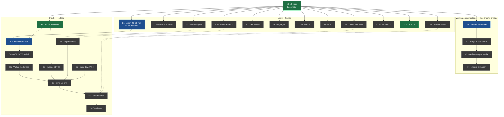
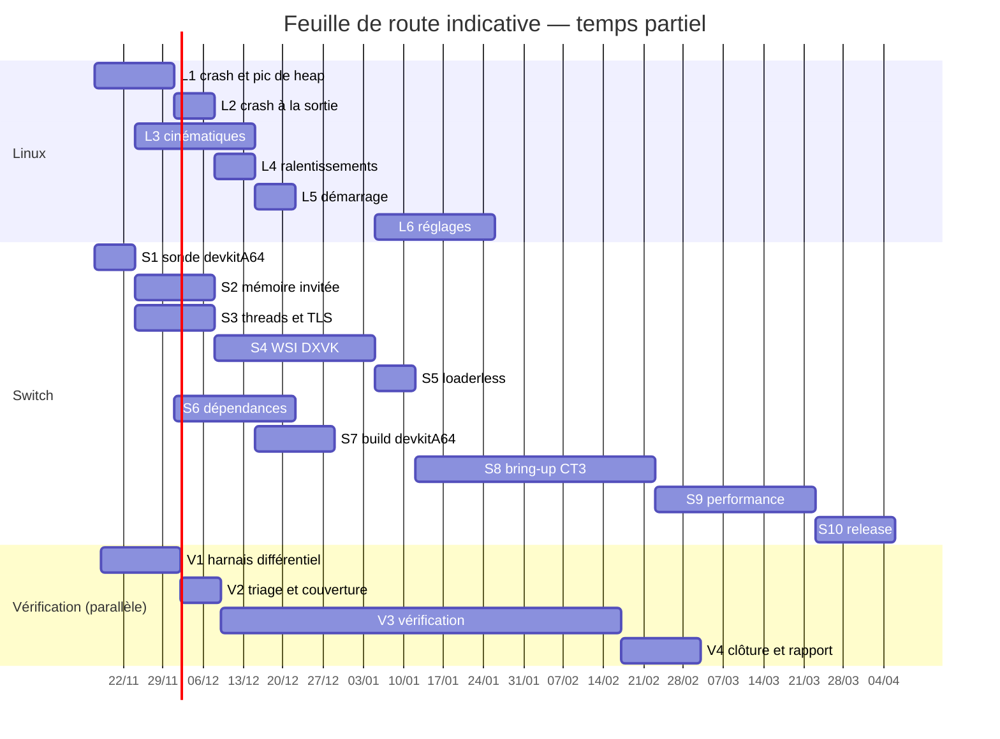

# Feuille de route — Crazy Taxi 3 sous Linux et sur Switch

> Statut : 18 novembre 2026, base `v0.1.0-linux` (`0d5dff7`).
> Ce document est le plan consolidé et traçable. Le détail technique du port Switch est dans
> [`SWITCH_PORT.md`](SWITCH_PORT.md) ; les décisions dans [`../DECISIONS.md`](../DECISIONS.md) ;
> les manques Linux dans [`TODO.md`](TODO.md).
>
> **Objectif** : décompilation complète et propre, puis exécutable Linux, puis exécutable Switch.
> « Complète » signifie **vérification sémantique fonction par fonction** (chantier `V`, §6, D-080).
> Ce chantier est **hors du chemin critique** des deux exécutables : il avance en parallèle et ne
> bloque ni `L*` ni `S*`.

## 1. Comment lire ce document

- `L*` : chantier Linux (stabilité et finition).
- `S*` : chantier Switch (portage du runtime ; il réutilise le code décompilé et recompilé).
- `V*` : chantier transversal de vérification sémantique (complétude de la décompilation),
  **hors chemin critique** des exécutables Linux et Switch.
- `G*` : porte de décision ; tant qu'elle n'est pas franchie, les tâches qui en dépendent
  restent indicatives.
- États : ✅ fait · 🔄 partiel ou en cours · ⬜ à faire · ⛔ bloqué.
- Les estimations sont en **semaines à temps partiel**, indicatives, et supposent une seule
  personne. Elles servent à ordonner, pas à promettre une date.
- Chaque tâche a un **critère d'acceptation vérifiable** : c'est la trace d'avancement.

## 2. Position actuelle

| Élément | État | Preuve |
|---|---|---|
| Traduction | ✅ faite | ~5 700 fonctions, ~443k instructions, 309 fonctions atteignables, aucun site p-code non supporté sur les chemins atteignables |
| Décompilation (complétude) | ⬜ défini, non démarré | vérification sémantique fonction par fonction : chantier `V1`–`V4` (§6), **hors chemin critique** ; la traduction seule ne suffit pas (D-080) |
| Runtime Linux | ✅ jouable | menus, course, son, manette ; tag `v0.1.0-linux` |
| Spike AArch64 Linux | ✅ vert | `f80_crosscheck`, `test_x87`, `test_g2`, `test_cpu`, `test_vec` |
| Toolchain Switch | ✅ validée | devkitA64 15.2.0, libnx ; compilation et link d'une sonde Switch |
| Sonde newlib (S1) | ✅ verte | binary128 LE, `ldexpl`/`frexpl` PASS, `char` non signé, `mmap` absent ; `tools/port/devkita64_probe.sh` |
| Runtime Switch | ⬜ non commencé | dépend de S2–S7 (S1 faite) |
| WSI Vulkan Switch | ⬜ non commencé | DXVK 3.1.1 n'a pas de backend Switch |
| Mémoire invitée Switch | 🔄 dimensionnée (planification) | pic mesuré 161 Mio après correctif L1.3 ; arène planifiée à 512 Mio tant que G2 n'est pas franchie (D-081) |

## 3. Vue d'ensemble

**Chemin critique Switch** : `S1 → S2 → S4 → S5 → S8 → S9 → S10` (`S1` faite le 17 nov. 2026).
**Chemin critique décompilation** : `V1 → V2 → V3 → V4`, mené **en parallèle** ; aucune arête ne va
de `V*` vers `L*` ou `S*`, donc il ne bloque ni les exécutables ni les portes `G2`–`G6`.
**Alimentation Linux → Switch** : `L1` fournit le pic de heap à `S2` ; `L3` et `L9` fournissent
les dépendances et les imports à `S6` ; `L4` et `L12` fournissent les mesures de performance à `S9`.

## 4. Chronologie indicative

`S1` a été exécutée le 17 novembre 2026, en avance sur le Gantt ; `G1` est franchie. `V*` est une
voie parallèle : elle n'a aucune arête vers `L*`/`S*` et ne décale aucune de leurs dates.

Lecture : Linux et Switch avancent en parallèle. Le port Switch ne dépend pas de la fin des
chantiers Linux, mais `L1` (pic de heap) et `L3`/`L9` (cinématiques, imports) réduisent ses risques.

## 5. Chantier Linux

| ID | Tâche | Critère d'acceptation | Dépend de | Est. | État | Réf. |
|---|---|---|---|---|---|---|
| **L1** | Crash après 20–30 min et « tas invité épuisé » | Session de 60 min sans faute ni épuisement du heap | — | 2 sem. | ⬜ | D-069, TODO |
| L1.1 | Instrumenter le pic de heap (`rt_proc.c`, `CT3_ALLOCLOG`, `CT3_HEAPCHK`) | Pic mesuré et consigné (octets, scénario) | — | 2 j | ✅ | D-076, SWITCH_PORT §3 |
| L1.2 | Reproduire et localiser la fuite ou la corruption | Cause identifiée (fuite, écriture hors bornes, objet non libéré) | L1.1 | 1 sem. | ✅ | D-077, D-078, D-079 |
| L1.3 | Corriger et vérifier | 60 min de course, aucun message « tas invité épuisé » | L1.2 | 3 j | 🔄 | correctif 18 nov. : `VirtualFree(MEM_RELEASE)` honoré et cache de transit D3D9 borné à 64 Mio ; A/B 143,9 Mio utilisés / pic 161 Mio contre 240,4 Mio / 243 Mio avec `CT3_VIRTUALFREE_NOOP=1` (79,7 Mio d'arènes libérées sur 84,7 Mio allouées) ; soak 60 min = clôture finale, non bloquant pour S2 (D-081) |
| **L2** | Crash à la sortie (`0x5154b5`, table `atexit`) | Sortie propre depuis le menu et depuis une course, code 0 | — | 1 sem. | 🔄 | D-078 |
| L2.1 | Lanceur `atexit` et nettoyages CRT (`0x514919`, `0x5164E5`, `0x5206C7`) | Fermeture de fenêtre : handlers exécutés, `ExitProcess(0)`, code 0 | — | 2 j | ✅ | D-078 |
| L2.2 | Sortie par le menu EXIT et depuis une course | Même résultat que L2.1 par les deux chemins | L2.1 | 3 j | 🔄 | menu EXIT: `atexit` OK, `ExitProcess(13)`, code 13 ; SIGTERM en course: `ExitProcess(0)`, code 0 |
| **L3** | Cinématiques | Intro, sélection de voiture et replay sans défaut visuel majeur | — | 3 sem. | 🔄 | D-061, TODO |
| L3.1 | Relever le défaut exact (capture `CT3_SHOT`) | Capture horodatée du bug, fichier et moment identifiés | — | 2 j | ⬜ | TODO |
| L3.2 | Graphe DirectShow factice : formats, `EC_COMPLETE`, boucle | cinepak 640×480 et rawvideo 128×128 lus sans figer la scène | L3.1 | 1 sem. | 🔄 | D-061 |
| L3.3 | Audio des cinématiques | Piste audio audible et synchronisée | L3.2 | 1 sem. | ⬜ | TODO |
| L3.4 | Polygones des personnages (`VERTEXBLEND`, `FUN_004E7813`) | Personnages corrects dans les cinématiques LV et SA | L3.1 | 2 sem. | ⬜ | TODO |
| **L4** | Ralentissements en jeu | Pic de frame time mesuré et ramené sous le seuil fixé | — | 1 sem. | ⬜ | D-013, TODO |
| L4.1 | Mesurer la compilation des shaders et pipelines | Temps de compilation et pics identifiés dans les journaux DXVK | — | 2 j | ⬜ | TODO |
| L4.2 | Cache DXVK et compilation asynchrone | Cache relu d'un lancement à l'autre ; pics réduits | L4.1 | 3 j | ⬜ | D-013 |
| L4.3 | Préchauffage au titre ou précompilation | Plus de pic au premier usage en course | L4.2 | 2 j | ⬜ | TODO |
| **L5** | Démarrage | Premier affichage sous la cible fixée (actuel : 9–10 s) | — | 1 sem. | 🔄 | D-068 à D-070 |
| L5.1 | Porter le bloc DXT3 `FUN_004F0019` (`param_2 == 0`) | Vérification bit à bit contre la traduction | — | 3 j | ⬜ | PORTAGE_FILTRE §11 |
| L5.2 | Modes 2 et 3 du filtre | Modes vérifiés ou documentés comme non utilisés | L5.1 | 2 j | ⬜ | PORTAGE_FILTRE |
| L5.3 | Décider du traitement des fondus de logo | Décision consignée (couvrir par la vidéo ou non) | — | 1 j | ⬜ | TODO |
| **L6** | Réglages | Résolution et sans bordure dans `Config.ini`, puis dans le menu du jeu | — | 3 sem. | ⬜ | TODO |
| L6.1 | Résolution et sans bordure dans `Config.ini` | Valeurs appliquées au lancement | — | 3 j | ⬜ | TODO |
| L6.2 | Implémenter les imports de dialogue | `DialogBoxParamA`, `EndDialog`, `GetDlgItem`, `IsDlgButtonChecked`, `CheckRadioButton` | L9 | 1 sem. | ⬜ | TODO |
| L6.3 | Écrire `Config.ini` depuis le menu du jeu | Réglages persistés après redémarrage | L6.2 | 1 sem. | ⬜ | TODO |
| **L7** | Manettes | Toutes les actions mappées, aucun double appui | — | 1 sem. | 🔄 | D-064, D-065 |
| L7.1 | Vérifier klaxon, Crazy Dash, validation des menus | Actions confirmées en jeu | — | 2 j | ⬜ | TODO |
| L7.2 | Corriger le double déplacement du curseur | Un appui = une entrée | — | 2 j | ⬜ | TODO |
| L7.3 | Mapping dans l'interface du jeu (v1.1) | Mapping modifiable et persisté | L6.3 | 3 j | ⬜ | TODO |
| **L8** | Son | Atténuation 3D audible, pas de clic, cinématiques sonores | — | 2 sem. | 🔄 | D-067 |
| L8.1 | Affiner l'atténuation 3D (cônes, orientation, écouteur) | Positionnement perceptible en jeu | — | 1 sem. | ⬜ | TODO |
| L8.2 | Interpolation du rééchantillonnage | Qualité audible, aucun accès hors bornes | — | 3 j | ⬜ | TODO |
| L8.3 | Audio des cinématiques | Voir L3.3 | L3.2 | — | ⬜ | TODO |
| **L9** | Win32 restants | 203 imports couverts ou documentés ; aucun arrêt code 3 | — | 2 sem. | 🔄 | TODO |
| L9.1 | Implémenter les 12 imports manquants | Aucun « import non implémenté » dans les journaux | — | 1 sem. | ⬜ | TODO |
| L9.2 | SEH et exceptions C++ (`RaiseException`, `RtlUnwind`) | Comportement correct ou import absent documenté ; pas de stub naïf | L9.1 | 1 sem. | ⬜ | TODO |
| L9.3 | Compléter `GetStringType` et `LCMapString` | Cas d'usage du jeu couverts | — | 2 j | ⬜ | TODO |
| **L10** | Tests et CI | Une commande exécute la suite ; CI verte sur push | — | 1 sem. | 🔄 | PACK.md |
| L10.1 | Script local `build-check` unique | `test_x87`, `test_g2`, `test_cpu`, `test_vec`, `g1` en une commande | — | 1 j | ⬜ | — |
| L10.2 | CI sans données de jeu | Compilation + `test_cpu` + `test_vec` verts sur GitHub Actions | L10.1 | 3 j | ⬜ | — |
| L10.3 | Spike AArch64 reproductible en CI | `tools/port/aarch64_spike.sh` exécuté par qemu (hors données de jeu) | L10.2 | 2 j | ⬜ | SWITCH_PORT §5 |
| **L11** | Licence du dépôt | `LICENSE` GPL-3.0-or-later ; notices tierces ; publication source seule documentée | — | 1 j | ✅ | D-082 |
| **L12** | Stabilité DXVK/Vulkan | 60 min sans `VK_ERROR_DEVICE_LOST` ; écran noir et fin de manche traités | — | 2 sem. | ⬜ | TODO |
| L12.1 | Reproduire `VK_ERROR_DEVICE_LOST` (BC-250/RADV) | Scénario et options DXVK identifiés | — | 3 j | ⬜ | TODO |
| L12.2 | Crash de fin de manche | Trace gdb et cause identifiées | — | 3 j | ⬜ | TODO |
| L12.3 | Écran noir intermittent | Scénario reproduit ou documenté comme non reproductible | — | 3 j | ⬜ | TODO |

### Définition de « Linux terminé »

- 60 minutes de course sans crash ni épuisement du heap.
- Aucun import atteignable non implémenté ; sortie propre.
- Cinématiques d'intro, de sélection et de replay lisibles (audio inclus ou limitation documentée).
- Réglages persistés et documentation à jour.
- Suite de tests et CI vertes.
- La vérification sémantique `V*` **n'est pas** un critère de cette définition : elle avance en
  parallèle et ne bloque pas l'exécutable Linux.

## 6. Chantier transversal — vérification sémantique de la décompilation

**La traduction n'est pas la décompilation.** La traduction prouve que le binaire est couvert et
que le C compile ; elle ne prouve pas que le C se comporte comme le code d'origine. La
**décompilation est complète** quand chaque fonction est couverte par une vérification sémantique
(D-080). Ce chantier définit donc la complétude, et il est **hors du chemin critique** des
exécutables Linux et Switch : aucune porte `G*` ne l'attend, aucun jalon `L*`/`S*` ne le précède.

Principe : **vérification différentielle** entre le code d'origine (`CT3.exe` exécuté sous
Unicorn x86-32, référence) et le code traduit (C compilé), à état initial identique — registres,
mémoire invitée, FPU/MMX/SSE, drapeaux, pile — puis comparaison de l'état final et des effets de
bord (imports rejoués par un enregistreur, appels sortants, écritures mémoire). Une fonction est
**vérifiée** si le différentiel est nul sur le corpus ; sinon l'écart est soit corrigé, soit
expliqué et documenté (valeur non déterministe, comportement non observable, différence assumée
de modèle d'exécution). Le corpus est généré localement depuis la copie de l'utilisateur et
**n'est jamais versionné** ; seule la graine et le générateur le sont.

| ID | Tâche | Critère d'acceptation | Dépend de | Est. | État | Réf. |
|---|---|---|---|---|---|---|
| **V1** | Harnais différentiel | Une fonction traduite et sa référence Unicorn sont comparées automatiquement | — | 2 sem. | ⬜ | `tools/ref/diff_run.py` |
| V1.1 | Référence par fonction | `diff_func` exécute une fonction sous Unicorn jusqu'à son `RET`, capture registres/mémoire/drapeaux ; 10 fonctions témoins (arithmétique, chaîne, FPU) sans écart | — | 1 sem. | ⬜ | `tools/ref/diff_run.py` |
| V1.2 | Replay des imports et déterminisme | Mêmes arguments et mêmes retours rejoués des deux côtés ; aucun écart dû au temps, aux handles ou au hasard | V1.1 | 3 j | ⬜ | `rt_shims.c` |
| V1.3 | Générateur et minimiseur de cas | Graine fixe reproductible ; valeurs limites, pointeurs valides, piles profondes ; cas minimal conservé par écart | V1.1 | 3 j | ⬜ | `tools/ref/gen_vectors.py` |
| **V2** | Triage et couverture | Chaque fonction du binaire a une classe et un statut | V1 | 1 sem. | ⬜ | export `build/g3/pcode_all.json` |
| V2.1 | Classer les ~5 747 fonctions | Classes : pure, état global, imports, FPU/MMX/SSE, threads, auto-modifiante, non retournante | V1 | 3 j | ⬜ | — |
| V2.2 | Fermeture d'appels des 309 atteignables | Carte de couverture : atteignables + appelés directs, taille du corpus par fonction | V2.1 | 2 j | ⬜ | `docs/g3_rapport.md` |
| V2.3 | Prioriser | Ordre de vérification : atteignables d'abord, puis fermeture, puis le reste | V2.2 | 1 j | ⬜ | — |
| **V3** | Vérification par famille | 0 écart non expliqué sur la famille traitée ; écarts consignés | V2 | 8–10 sem. | ⬜ | — |
| V3.1 | Fonctions pures (arithmétique, chaînes, mémoire) | Corpus ≥ 100 cas par fonction, différentiel nul | V2.3 | 3 sem. | ⬜ | — |
| V3.2 | FPU/MMX/SSE (x87 80 bits, `FPREM`, conversions) | Différentiel nul sur les cas limites et aléatoires, y compris dénormalisés/NaN | V2.3 | 2 sem. | ⬜ | `tests/x87`, `rt_fp.h` |
| V3.3 | État global et structures (COM, D3D9 invité) | État final identique sur les objets et vtables exercés | V2.3 | 2 sem. | ⬜ | `rt_d3d9*.cpp` |
| V3.4 | Fonctions avec imports | Parité des shims : mêmes arguments, mêmes retours, mêmes effets | V2.3 | 2 sem. | ⬜ | `rt_shims.c` |
| **V4** | Clôture | Rapport de complétude publié et rejouable | V3 | 2 sem. | ⬜ | — |
| V4.1 | Fonctions non atteignables | Chacune est prouvée inatteignable (analyse statique) ou vérifiée | V3 | 1 sem. | ⬜ | — |
| V4.2 | Rapport `docs/VERIF_SEMANTIQUE.md` | Matrice fonction → classe → statut → preuve (cas, commit) ; écarts connus listés | V3 | 3 j | ⬜ | — |
| V4.3 | Non-régression en CI | Corpus synthétique (sans donnée de jeu) vert ; corpus local rejouable par une commande | V4.2 | 3 j | ⬜ | L10.2 |

### Définition de « décompilation complète »

- 100 % des fonctions du binaire sont classées (V2.1).
- 0 écart non expliqué sur les 309 fonctions atteignables et leur fermeture d'appels directs (V3).
- Chaque fonction non atteignable est prouvée inatteignable ou vérifiée (V4.1).
- Les écarts connus sont listés avec leur justification, leur impact et la décision associée.
- `tools/recomp/verify_semantics.sh` rejoue le corpus et produit le rapport ; la CI reste verte
  sur le corpus synthétique, sans donnée de jeu versionnée (V4.2, V4.3).

### Ce que ce chantier ne couvre pas

- La performance : elle relève de `L4`, `L12` et `S9`.
- Les imports Win32 eux-mêmes : leur parité est testée côté invité (V3.4), mais leur sémantique
  hôte relève de `L9`.
- La validation matérielle Switch : elle relève de `S8`–`S10`.

## 7. Chantier Switch

| ID | Tâche | Critère d'acceptation | Dépend de | Est. | État | Réf. |
|---|---|---|---|---|---|---|
| **S1** | Sonde devkitA64/newlib | Résultats consignés : `sizeof(long double)`, `LDBL_MANT_DIG`, `LDBL_MAX_EXP`, boutisme, `ldexpl`/`frexpl`, `char`, `pthread`, `mmap`, `clock_gettime`, `__thread` | — | 1 sem. | ✅ | SWITCH_PORT §2, `tools/port/devkita64_probe.sh` |
| **S2** | Mémoire invitée | Une fonction traduite s'exécute sur Switch dans une arène dimensionnée | L1.1, S1 | 2 sem. | ⬜ | SWITCH_PORT §3 |
| S2.1 | Pic de heap | Pic mesuré (partagé avec L1.1) | L1.1 | — | 🔄 | D-076, D-081, SWITCH_PORT §3 : pic **stabilisé à 161 Mio** après correctif L1.3 (143,9 Mio utilisés sur 360 s) ; marge de planification 512 Mio conservée jusqu'au soak 60 min |
| S2.2 | Abstraire `rt_va_reserve/commit/protect` | Implémentation Linux inchangée, interface commune | S1 | 1 sem. | ⬜ | rt_mem.c |
| S2.3 | Arène Horizon (`virtmemFindAslr` + `svcMapMemory`) | Image + scratch + pile + heap + stubs mappés | S2.2 | 1 sem. | ⬜ | rt_proc.h, S1 |
| S2.4 | Valider pointeurs 32 bits et `test_g2` | `test_g2` vert sur AArch64 Linux ; smoke test Switch | S2.3 | 3 j | ⬜ | — |
| **S3** | Threads et TLS | Démarrage, threads invités et sortie propres | S1 | 2 sem. | ⬜ | rt_thread.c |
| S3.1 | Remplacer `pthread_cancel` | Annulation coopérative, aucun thread orphelin | — | 3 j | ⬜ | rt_thread.c:235 |
| S3.2 | Backend Horizon (`svcCreateThread`, TLS) | Threads invités fonctionnels | S3.1 | 1 sem. | ⬜ | — |
| S3.3 | Tests de sortie et de session longue | Sortie propre ; pas de fuite de threads | S3.2 | 3 j | ⬜ | — |
| **S4** | WSI DXVK Switch | Swapchain 720p présentée, puis triangle DXVK | S2 | 4 sem. | ⬜ | SWITCH_PORT §3 |
| S4.1 | Squelette `src/wsi/switch/*` + option meson | Compilation avec `-DDXVK_WSI_SWITCH` | — | 3 j | 🔄 | DXVK 3.1.1 local (`~/.local/ct3-deps/src/dxvk`) |
| S4.2 | `createSurface` via `vkCreateViSurfaceNN` | Surface créée avec un `NWindow*` | S4.1 | 1 sem. | ⬜ | `wsi_platform.h` |
| S4.3 | Fenêtre NWindow sans SDL | Fenêtre plein écran 720p/1080p, pas de redimensionnement | S4.1 | 1 sem. | ⬜ | rt_win.cpp:145 |
| S4.4 | Smoke test Vulkan puis triangle DXVK | Image présentée à l'écran | S4.2, S4.3 | 1 sem. | ⬜ | — |
| **S5** | Vulkan loaderless | DXVK s'initialise sans `libvulkan.so` | S4 | 1 sem. | ⬜ | `vulkan_loader.cpp` |
| S5.1 | Constructeur `LibraryLoader(PFN_vkGetInstanceProcAddr)` | Injection d'un pointeur statique | — | 2 j | ⬜ | — |
| S5.2 | Injecter `vkGetInstanceProcAddr` au démarrage | Instance et device créés | S5.1 | 2 j | ⬜ | mesa-switch |
| S5.3 | Vérifier le chargement des fonctions | Aucun `dlopen`, tous les pointeurs résolus | S5.2 | 1 j | ⬜ | — |
| **S6** | Dépendances | Link statique complet, aucun `dlopen` | S1 | 3 sem. | ⬜ | SWITCH_PORT §3 |
| S6.1 | FFmpeg minimal ou cinématiques désactivées | Bring-up sans FFmpeg, puis réintroduction | — | 1 sem. | ⬜ | — |
| S6.2 | Police embarquée (Liberation Sans) | Texte du jeu rendu sans fontconfig | — | 3 j | ⬜ | — |
| S6.3 | SDL2 Switch ou backend libnx | Fenêtre, entrées et audio fonctionnels | S4.3 | 1 sem. | ⬜ | — |
| S6.4 | zlib et autres dépendances | Link statique vert | — | 3 j | ⬜ | — |
| **S7** | Build devkitA64 | `cmake --build` produit un NRO qui démarre | S1 | 2 sem. | ⬜ | — |
| S7.1 | `cmake/toolchains/switch.cmake` | Configure et compile la runtime | — | 1 sem. | ⬜ | — |
| S7.2 | `-fsigned-char`, link statique, sans `dlopen` | Aucun avertissement bloquant | S7.1 | 3 j | ⬜ | — |
| S7.3 | Empaquetage NRO | NRO lancé sur matériel homebrew | S7.2 | 3 j | ⬜ | — |
| **S8** | Bring-up CT3 | Menus 2D puis une course jouable en 720p | S3, S5, S6, S7 | 6 sem. | ⬜ | — |
| S8.1 | Premier affichage (clear screen) | Image stable, pas de crash | S7.3 | 1 sem. | ⬜ | — |
| S8.2 | Menus 2D (textures, police, entrées) | Navigation complète au joystick | S8.1, S6.2 | 2 sem. | ⬜ | — |
| S8.3 | Une course en 720p | Rendu, entrées et audio fonctionnels | S8.2 | 3 sem. | ⬜ | — |
| **S9** | Performance | Cadence stable, seuil fixé (30 fps minimum, 60 si possible) | S8 | 4 sem. | ⬜ | SWITCH_PORT §3 |
| S9.1 | Profiler CPU, GPU, conversions x87, DXVK | Goulots identifiés et chiffrés | S8.3 | 1 sem. | ⬜ | — |
| S9.2 | Overrides natifs et cache de pipelines | Gains mesurés sur les fonctions chaudes | S9.1 | 2 sem. | ⬜ | rt_filter.c |
| S9.3 | Réduction de résolution ou qualité si besoin | Seuil tenu en portable | S9.2 | 1 sem. | ⬜ | — |
| **S10** | Release | NRO publiable sans donnée de jeu | S9 | 2 sem. | ⬜ | — |
| S10.1 | Stabilité 1 h | Aucun crash connu | S9 | 1 sem. | ⬜ | — |
| S10.2 | Empaquetage, README, mentions légales | Instructions d'installation claires | S10.1 | 3 j | ⬜ | — |
| S10.3 | Mode docké 1080p (optionnel) | Résolution commutée sans redémarrage | S10.2 | 1 sem. | ⬜ | — |

### Définition de « Switch terminé »

- NRO homebrew qui démarre sans SDK Nintendo ni donnée de jeu versionnée.
- Menus et une course jouables en 720p portable, entrées et audio.
- 30 fps minimum stable, sortie propre, session d'une heure sans crash.
- Instructions de build et de génération du pack documentées.
- La vérification sémantique `V*` **n'est pas** un critère de cette définition : elle avance en
  parallèle et ne bloque pas l'exécutable Switch.

## 8. Portes de décision

| Porte | Question | Donnée d'entrée | Conséquence si « non » | État |
|---|---|---|---|---|
| **G1** | `long double` de newlib est-il binary128 little-endian ? | Sonde S1 | Type `extFloat80` logiciel, tests x87 supplémentaires | ✅ franchie : binary128 LE, 113 bits, exp 16384 |
| **G2** | Le pic de heap tient-il dans une arène contiguë Horizon ? | Mesure L1.1 / S2.1 | Table de pages derrière `guest_ld`/`guest_st` | ⬜ en attente (contournement : planifier 512 Mio, alertes `CT3_HEAP_WARN_*` ; pic stabilisé à 161 Mio après correctif L1.3, soak 60 min requis pour clore) |
| **G3** | `mesa-switch` crée-t-il une surface et une swapchain stables ? | Smoke test S4.4 | Revoir le WSI ou la version de mesa | ⬜ en attente |
| **G4** | DXVK s'initialise-t-il sans loader Vulkan ? | S5.3 | Patch de chargement statique plus profond | ⬜ en attente |
| **G5** | Une course complète tient-elle en 720p ? | S8.3 | Réduire le périmètre du bring-up (cinématiques, replay) | ⬜ en attente |
| **G6** | Le seuil de performance est-il tenu ? | S9 | Résolution dynamique, overrides natifs, report de la release | ⬜ en attente |

## 9. Matrice de traçabilité

| Exigence | Tâches | Preuve attendue | Où c'est consigné |
|---|---|---|---|
| Le jeu Linux tient 60 min sans crash | L1, L12 | Journal de session, compteur de heap, absence de faute | `TODO.md`, `DECISIONS.md` |
| Les cinématiques sont correctes | L3 | Captures avant/après, lecture des trois familles de fichiers | `TODO.md` |
| Les 203 imports sont couverts | L9 | Journal sans « non résolu », tableau des imports | `TODO.md` |
| Les réglages sont persistés | L6 | `Config.ini` relu après redémarrage | `TODO.md` |
| Le format `long double` est tranché | S1, G1 | Sonde `RESULT=PASS`, macros devkitA64, link libnx | `SWITCH_PORT.md`, `DECISIONS.md` |
| La décompilation est complète (sémantique) | V1–V4 | Rapport fonction → statut → preuve, 0 écart non expliqué | `ROADMAP.md` §6, `VERIF_SEMANTIQUE.md`, D-080 |
| Le port Switch démarre | S2–S8 | NRO qui boote, première course | `SWITCH_PORT.md` |
| Le port Switch tient 30 fps | S9 | Profiling, captures de frame time | `SWITCH_PORT.md` |
| Aucune donnée de jeu versionnée | L11, S10 | `git ls-files`, `.gitignore`, contrat du pack | `PACK.md` |
| La base Linux est reproductible | L10 | Script unique + CI verte | `README.md` |

## 10. Trace d'exécution

Ordre recommandé, à cocher au fur et à mesure. Les tâches Linux et Switch peuvent avancer en
parallèle ; la trace donne l'ordre qui réduit le plus les risques.

- [x] **M0** · base Linux figée, tag `v0.1.0-linux`
- [x] **M1** · spike AArch64 (x87, G2, CPU, VEC, f80)
- [x] **S1** · sonde devkitA64 (17 nov. 2026) — `tools/port/devkita64_probe.sh`, `RESULT=PASS`
- [x] **G1** · format `long double` tranché : binary128 little-endian
- [x] **L1.1** · instrumentation et mesure du pic de heap
- [ ] **L1.3** · validation 60 min continue (correctif appliqué : `VirtualFree` honoré, cache borné — D-081) ← *prochaine action*
- [ ] **S2** · mémoire invitée et arène
- [ ] **G2** · taille d'arène validée
- [ ] **S4.1** · squelette WSI DXVK Switch (patch déposé, build cross à valider)
- [ ] **S4** · WSI DXVK Switch
- [ ] **S5** · Vulkan loaderless
- [ ] **G3/G4** · surface, swapchain et DXVK sans loader
- [ ] **S3** · threads et TLS
- [ ] **S6** · dépendances
- [ ] **S7** · build devkitA64 et NRO
- [ ] **S8** · bring-up : premier affichage, menus, course
- [ ] **G5** · première course jouable
- [ ] **S9** · performance
- [ ] **G6** · seuil de cadence tenu
- [ ] **S10** · release
- [ ] **L2** · crash à la sortie
- [ ] **L3** · cinématiques
- [ ] **L4** · ralentissements
- [ ] **L5** · démarrage
- [ ] **L6** · réglages
- [ ] **L7** · manettes
- [ ] **L8** · son
- [ ] **L9** · Win32 restants
- [ ] **L10** · tests et CI
- [x] **L11** · licence (GPL-3.0-or-later, D-082)
- [ ] **L12** · stabilité DXVK
- [ ] **V1** · harnais différentiel (parallèle, hors chemin critique)
- [ ] **V2** · triage et couverture des ~5 747 fonctions
- [ ] **V3** · vérification par famille (atteignables d'abord)
- [ ] **V4** · rapport de complétude et non-régression

## 11. Risques

| Risque | Probabilité | Impact | Réduction |
|---|---|---|---|
| ~~`long double` de newlib = `double` (53 bits)~~ | — | — | Retiré par S1 : binary128 little-endian confirmé |
| `char` non signé par défaut sur AArch64 | certaine | moyen | `-fsigned-char` dans la toolchain Switch (S1) |
| Arène contiguë trop grande pour Horizon | moyenne | élevé | Mesure L1.1/S2.1 (pic stabilisé 161 Mio), marge de planification 512 Mio ; repli sur table de pages |
| NVK/mesa-switch instable sur les shaders de CT3 | moyenne | élevé | Smoke test S4.4 tôt ; versions de mesa épinglées |
| SDL2 Switch incompatible avec Vulkan | moyenne | moyen | Backend libnx dédié (S6.3) |
| FFmpeg difficile à cross-compiler | faible | moyen | Désactiver les cinématiques au premier bring-up |
| Performance sous 30 fps | moyenne | élevé | Profiling S9.1, overrides natifs, résolution dynamique |
| Écart sémantique silencieux dans le code traduit | moyenne | moyen | Vérification différentielle V1–V4 (hors chemin critique) ; tests de non-régression V4.3 |
| Vérification perçue comme un prérequis bloquant | moyenne | moyen | Chantier `V*` explicitement parallèle : aucune porte `G*` ne l'attend (D-080) |
| Temps partiel et dispersion Linux/Switch | élevée | moyen | Jalons courts, chemin critique explicite, une seule priorité à la fois |
| Utilisation d'un SDK ou d'un code sous NDA | faible | très élevé | Rester sur devkitPro/libnx/mesa-switch, aucun SDK Nintendo |

## 12. Prochaines actions (deux semaines)

**S1/G1 franchies ; L1.1, L1.2, L1.3 (correctif), L2.1, S2.1 (pic stabilisé), S4.1 (squelette) avancés** (18 nov. 2026). Prochaines actions :

1. **L1.3 — clôture** : soak de 60 min avec le correctif (`VirtualFree` honoré, cache de transit D3D9 borné à 64 Mio), `CT3_HEAPSTATS=1`, `CT3_ALLOCSTATS=1` ; consigner plateau, pic et `ExitProcess`. Non bloquant pour S2 (marge 512 Mio).
2. **L2/L2.2** — Confirmer le code de sortie nominal du menu EXIT (13 observé, teardown propre) ou ajuster la séquence pour atteindre l'item EXIT exact ; clôturer L2 si les chemins jeu sont propres.
3. **S4.1** — Valider la compilation du squelette DXVK Switch avec `-Dnative_switch=true` en cross devkitA64/libnx (`tools/port/dxvk-3.1.1-switch-wsi-s4.1.patch`) ; corriger les points de build.
4. **S2.2** — Abstraire `rt_va_reserve/commit/protect` (interface commune, comportement Linux inchangé) en préparation de l'arène Horizon, en planifiant 512 Mio de marge.
5. **V1** — Démarrer le harnais différentiel **en parallèle** (hors chemin critique) : `diff_func` sur 10 fonctions témoins, replay des imports, puis V2. Aucune attente entre `V*` et `L*`/`S*`.

## 13. Mise à jour

Ce document est mis à jour à chaque fin de tâche : cocher la trace (§10), changer l'état dans le
tableau du chantier, et consigner la preuve (commande, journal, commit) dans la colonne `Réf.`.
Le statut fait foi ; les dates du Gantt sont indicatives.

---

*Créé le 17 novembre 2026, sur la base `v0.1.0-linux` (`0d5dff7`).*
